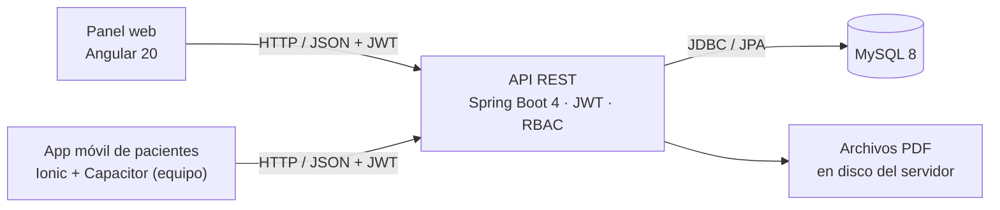

# U-Medical

Sistema distribuido para la **gestión de servicios médicos**: agendamiento de citas, agendas médicas, registro de consultas (diagnósticos y recetas con PDF adjunto) y administración de la clínica.

> Proyecto universitario. Se compone de un **panel web** (Angular), una **API REST** (Spring Boot) y una **base de datos** (MySQL). La **app móvil para pacientes** (Ionic) la desarrolla otro integrante del equipo y consume la misma API (ver [`docs/API-MOVIL.md`](docs/API-MOVIL.md)).

---

## Contenido

1. [Qué hace el sistema](#qué-hace-el-sistema)
2. [Arquitectura](#arquitectura)
3. [Tecnologías](#tecnologías)
4. [Estructura del repositorio](#estructura-del-repositorio)
5. [Inicio rápido](#inicio-rápido)
6. [Usuarios de prueba](#usuarios-de-prueba)
7. [Documentación](#documentación)
8. [Cumplimiento del enunciado](#cumplimiento-del-enunciado)
9. [Decisiones de diseño](#decisiones-de-diseño)
10. [Alcance actual y trabajo pendiente](#alcance-actual-y-trabajo-pendiente)
11. [Equipo](#equipo)

---

## Qué hace el sistema

Cuatro perfiles de usuario, cada uno con su propia área en el panel web:

| Perfil | Qué puede hacer |
|---|---|
| **Paciente** | Registrarse, ver el directorio de médicos, **agendar** citas eligiendo médico, día y horario disponible, **reagendar** y **cancelar**, ver su historial con los **diagnósticos, recetas y PDF** de cada consulta, y editar su perfil y contraseña. |
| **Secretaria** | Ver el **calendario de todos los médicos**, buscar y **registrar pacientes** en recepción (con contraseña temporal), **agendar a nombre de un paciente**, reagendar y cancelar. |
| **Médico** | Ver su **agenda semanal**, y registrar **diagnóstico y receta** (con PDF opcional) de las citas atendidas. El historial de cada cita se conserva: las entradas se agregan, no se sobrescriben. |
| **Administrador** | **Panel con gráficas** (citas por estado, especialidad, médico y día), gestión de **usuarios y roles**, **médicos** (alta con horarios, edición, activar/desactivar), **edición de horarios**, especialidades, y todo lo de la secretaria. |

Reglas de negocio destacadas:

- Un horario **no se puede reservar dos veces**: se valida en la aplicación y, como última defensa, con una restricción única en la base de datos.
- Solo se puede reservar un horario que **exista en la agenda del médico** y que no esté ocupado ni demasiado próximo (mínimo 60 minutos de anticipación).
- El paciente solo puede cancelar o reagendar con **al menos 2 horas** de anticipación.
- Los documentos clínicos solo se registran en citas **de hoy o anteriores**, nunca en citas futuras ni canceladas.
- No se puede cambiar un horario ni desactivar a un médico si eso deja **citas pendientes** sin atención.

## Arquitectura



- **Arquitectura por capas en el backend:** `controller` → `service` (reglas de negocio y transacciones) → `repository` (Spring Data JPA) → `entity`.
- **Autenticación sin estado (stateless)** con JWT: cada petición lleva `Authorization: Bearer <token>`; el servidor no guarda sesiones.
- **Control de acceso por roles (RBAC)** definido en `SecurityConfig` y reforzado en los servicios (por ejemplo, un doctor solo puede documentar sus propias citas).

## Tecnologías

| Capa | Tecnología |
|---|---|
| Backend | Java 21 · Spring Boot 4.1 · Spring Data JPA (Hibernate) · Spring Security 7 · Maven |
| Seguridad | JWT (jjwt 0.12) · BCrypt · CORS explícito · límite de intentos por IP · captcha opcional (Cloudflare Turnstile) |
| Documentación de la API | OpenAPI / Swagger UI (springdoc 3.0) · colección de Postman |
| Base de datos | MySQL 8 (modelo en 3FN, claves foráneas, restricciones `CHECK` y columna generada) |
| Panel web | Angular 20 (componentes *standalone*, carga diferida por ruta, formularios reactivos, RxJS, interceptor y guards funcionales) · SCSS |
| App móvil | Ionic + Capacitor |

## Estructura del repositorio

```
u_medical/
├── README.md                      ← este archivo
├── database/
│   ├── schema.sql                 ← esquema + datos semilla (3FN)
│   ├── DER.md                     ← diagrama entidad-relación y diccionario de datos
│   ├── seed-secretaria.sql        ← (opcional) usuario de prueba con rol secretaria
│   └── seed-citas-pasadas.sql     ← (opcional) citas pasadas con diagnóstico y receta
├── backend/                       ← API REST (Spring Boot)
│   └── src/main/java/com/umedical/umedical/
│       ├── config/                ← seguridad, CORS, OpenAPI, reloj de la clínica
│       ├── controller/            ← endpoints REST
│       ├── dto/                   ← objetos de entrada/salida con validaciones
│       ├── entity/                ← entidades JPA (entity/enumns: enums)
│       ├── exception/             ← manejo global de errores (@RestControllerAdvice)
│       ├── repository/            ← repositorios Spring Data
│       ├── security/              ← JWT, filtros, límite de intentos
│       └── service/               ← reglas de negocio
├── frontend/                      ← panel web (Angular)
│   └── src/app/
│       ├── core/                  ← modelos, servicios HTTP, guards, interceptor
│       ├── shared/                ← componentes reutilizables (selector de horarios, captcha)
│       └── features/              ← pantallas por perfil (auth, patient, staff, doctor, admin)
├── postman/
│   └── u-medical-api.postman_collection.json   ← 113 pruebas de la API
└── docs/
    ├── manual-del-sistema.md
    ├── guia-instalacion-despliegue.md
    ├── documentacion-api.md
    ├── API-MOVIL.md               ← guía de la API para la app móvil
    ├── reporte-de-pruebas.md
    ├── guion-de-demo.md
    └── capturas/                  ← evidencias (capturas de pantalla)
```

## Inicio rápido

Requisitos: **JDK 21**, **Node.js 20+** con **Angular CLI 20**, **MySQL 8** y Git. La guía completa está en [`docs/guia-instalacion-despliegue.md`](docs/guia-instalacion-despliegue.md).

```bash
# 1. Base de datos (crea u_medical; BORRA la base si ya existía)
mysql -u root -p < database/schema.sql
mysql -u root -p < database/seed-secretaria.sql        # opcional: usuario secretaria
mysql -u root -p < database/seed-citas-pasadas.sql     # opcional: citas pasadas de ejemplo

# 2. Secretos locales del backend (este archivo no se sube a Git)
#    backend/src/main/resources/local.properties
#      spring.datasource.password=TU_PASSWORD_DE_MYSQL
#      app.jwt.secret=UNA_CADENA_ALEATORIA_DE_AL_MENOS_32_CARACTERES

# 3. Backend  → http://localhost:8080
cd backend
./mvnw spring-boot:run

# 4. Panel web  → http://localhost:4200   (en otra terminal)
cd frontend
npm install
ng serve
```

| Servicio | URL |
|---|---|
| Panel web | http://localhost:4200 |
| API REST | http://localhost:8080/api/v1 |
| Swagger UI | http://localhost:8080/swagger-ui.html |
| Especificación OpenAPI (JSON) | http://localhost:8080/api-docs |

## Usuarios de prueba

Cargados por los datos semilla. **La contraseña de todos es `password`** (solo para desarrollo: cámbiala en cualquier entorno compartido).

| Usuario | Rol | Notas |
|---|---|---|
| `admin` | Administrador | Entra al Panel |
| `secretaria1` | Secretaria | Requiere `database/seed-secretaria.sql` |
| `dr.perez` | Médico | Medicina General · atiende lunes y miércoles 08:00–12:00 |
| `dra.lopez` | Médico | Cardiología · atiende martes 14:00–18:00 |
| `paciente1` | Paciente | Tiene citas de ejemplo si se cargó `seed-citas-pasadas.sql` |

## Documentación

| Documento | Contenido |
|---|---|
| [Manual del sistema](docs/manual-del-sistema.md) | Instalación, configuración y **uso de cada pantalla por perfil**. |
| [Guía de instalación y despliegue](docs/guia-instalacion-despliegue.md) | Requisitos, puesta en marcha local, configuración, despliegue y solución de problemas. |
| [Documentación de la API](docs/documentacion-api.md) | Todos los endpoints, roles, ejemplos, códigos de error y reglas. Complementa a **Swagger UI**. |
| [Guía de la API para la app móvil](docs/API-MOVIL.md) | Flujo del paciente y conexión desde un teléfono o emulador. |
| [Reporte de pruebas](docs/reporte-de-pruebas.md) | Plan de pruebas, casos manuales por perfil, pruebas de API y registro de defectos. |
| [Guion de demo](docs/guion-de-demo.md) | Recorrido de punta a punta para la presentación. |
| [DER y diccionario de datos](database/DER.md) | Modelo de datos, normalización y reglas de integridad. |

## Decisiones de diseño

- **Documentos clínicos separados de la cita.** El diagnóstico y la receta viven en la tabla `documents` (tipo, contenido, PDF opcional) y no como columnas de `appointments`. Permite listar documentos sin recorrer citas, pacientes y médicos, adjuntar archivos y **conservar un historial**: cada registro nuevo se agrega y no sobrescribe al anterior.
- **Citas canceladas liberan el horario.** La restricción única de la base de datos incluye una columna generada (`active_slot`) que vale `NULL` cuando la cita está cancelada, de modo que ese horario se puede volver a reservar sin perder la protección contra duplicados entre citas activas.
- **Bajas lógicas.** Usuarios, médicos y bloques de horario se desactivan en lugar de borrarse, para no perder el historial clínico.
- **La reserva valida contra la agenda del médico.** No basta con que el horario esté libre: debe pertenecer a un bloque configurado y cumplir la anticipación mínima.
- **Códigos HTTP con significado.** 400 datos inválidos · 401 sin sesión o sesión vencida · 403 sin permiso · 404 no existe · 409 conflicto con el estado actual · 429 demasiados intentos. Todos con el mismo cuerpo JSON de error.
- **Zona horaria de la clínica configurable** (`app.clinic-timezone`), independiente de la del servidor, para que las reglas de anticipación sean correctas en cualquier despliegue.

## Alcance actual y trabajo pendiente

Esta entrega cubre las funcionalidades descritas arriba (bloques de trabajo 0 a 4). Queda pendiente, planificado para las siguientes iteraciones:

- Autogestión de horarios por el médico y bloqueo de días (vacaciones, ausencias); expediente completo del paciente para el médico; estadísticas propias del médico.
- Pruebas automatizadas unitarias y de integración (hoy: colección de Postman con 113 casos y plan de pruebas manuales con evidencia).
- Verificación de correo y recordatorios por email; estado «no asistió»; exportación de reportes; bitácora de auditoría.
- Despliegue con Docker Compose.
- Archivos de entorno de Angular (la URL de la API está en `frontend/src/app/core/api.config.ts`).

Limitaciones conocidas: la sesión dura 24 horas y no hay *refresh token*; el límite de intentos por IP funciona en memoria (una sola instancia del backend); las citas pasadas que nadie atendió se muestran como «Sin atender».

## Equipo

Samuel Alejandro Hernandez Reyes -> backend y panel web
Josue David Fajardo Guzman -> app móvil
