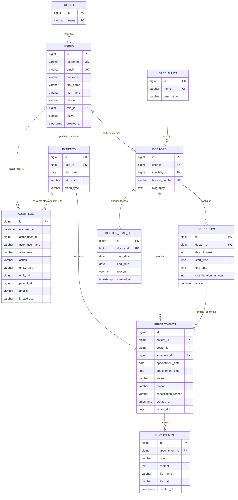

# Modelo de datos — Diagrama Entidad-Relación

Base de datos **`u_medical`** . El script completo está en [`schema.sql`](schema.sql).

## Diagrama

<https://mermaid.live>.

`active_slot` en `APPOINTMENTS` es una columna generada (ver *Reglas de integridad*). En `DOCTORS` y `PATIENTS`, `user_id` además es único (relación 1 a 1 con `USERS`).

Las líneas punteadas hacia `AUDIT_LOG` son **referencias lógicas, no llaves foráneas**: la bitácora debe conservarse aunque se desactive o se borre el usuario o el paciente al que se refiere (ver la sección de `audit_log`).

## Diccionario de datos

**PK** clave primaria · **FK** clave foránea · **UK** valor único · **NN** no nulo.

### `roles`
| Columna | Tipo | Restricciones | Descripción |
|---|---|---|---|
| `id` | BIGINT | PK, auto-incremental | |
| `name` | VARCHAR(30) | UK, NN | `ROLE_ADMIN`, `ROLE_DOCTOR`, `ROLE_PATIENT`, `ROLE_SECRETARY` |

### `users`
Tabla unificada de usuarios; el rol se discrimina con `role_id`.

| Columna | Tipo | Restricciones | Descripción |
|---|---|---|---|
| `id` | BIGINT | PK | |
| `username` | VARCHAR(50) | UK, NN | Nombre de usuario para iniciar sesión |
| `email` | VARCHAR(100) | UK, NN | |
| `password` | VARCHAR(255) | NN | Hash **BCrypt** (nunca la contraseña en claro) |
| `first_name`, `last_name` | VARCHAR(80) | NN | |
| `phone` | VARCHAR(20) | | |
| `role_id` | BIGINT | FK → `roles.id`, NN | |
| `active` | BOOLEAN | NN, por defecto `TRUE` | Una cuenta inactiva no puede iniciar sesión ni operar |
| `created_at` | TIMESTAMP | NN, por defecto la fecha actual | |

### `specialties`
| Columna | Tipo | Restricciones |
|---|---|---|
| `id` | BIGINT | PK |
| `name` | VARCHAR(100) | UK, NN |
| `description` | VARCHAR(255) | |

### `doctors`
Perfil profesional; extiende a `users` en relación 1 a 1.

| Columna | Tipo | Restricciones | Descripción |
|---|---|---|---|
| `id` | BIGINT | PK | |
| `user_id` | BIGINT | FK → `users.id`, UK, NN, `ON DELETE CASCADE` | |
| `specialty_id` | BIGINT | FK → `specialties.id`, NN | |
| `license_number` | VARCHAR(50) | UK, NN | Número de colegiado |
| `biography` | TEXT | | |

### `patients`
Datos propios del paciente; extiende a `users` en relación 1 a 1.

| Columna | Tipo | Restricciones | Descripción |
|---|---|---|---|
| `id` | BIGINT | PK | |
| `user_id` | BIGINT | FK → `users.id`, UK, NN, `ON DELETE CASCADE` | |
| `birth_date` | DATE | | |
| `address` | VARCHAR(255) | | |
| `blood_type` | VARCHAR(5) | | Ej. `O+`, `AB-` |

### `schedules`
Bloques de atención semanales de cada médico.

| Columna | Tipo | Restricciones | Descripción |
|---|---|---|---|
| `id` | BIGINT | PK | |
| `doctor_id` | BIGINT | FK → `doctors.id`, NN, `ON DELETE CASCADE` | |
| `day_of_week` | INT | NN, `CHECK` entre 1 y 7 | 1 = lunes … 7 = domingo |
| `start_time`, `end_time` | TIME | NN, `CHECK (end_time > start_time)` | |
| `slot_duration_minutes` | INT | NN, por defecto 30 | Duración de cada cita dentro del bloque |
| `active` | BOOLEAN | NN, por defecto `TRUE` | Baja lógica del bloque |

### `appointments`
| Columna | Tipo | Restricciones | Descripción |
|---|---|---|---|
| `id` | BIGINT | PK | |
| `patient_id` | BIGINT | FK → `patients.id`, NN | |
| `doctor_id` | BIGINT | FK → `doctors.id`, NN | |
| `schedule_id` | BIGINT | FK → `schedules.id` | Bloque de origen (opcional) |
| `appointment_date` | DATE | NN | |
| `appointment_time` | TIME | NN | |
| `status` | VARCHAR(20) | NN, `CHECK`, por defecto `PENDIENTE` | `PENDIENTE`, `COMPLETADA`, `CANCELADA`, `NO_ASISTIO` (el paciente no se presentó a una cita que ya empezó) |
| `reason` | VARCHAR(255) | | Motivo de la consulta |
| `cancellation_reason` | VARCHAR(255) | | Motivo si la cita se canceló |
| `created_at` | TIMESTAMP | NN | |
| `active_slot` | TINYINT | **columna generada** (`STORED`) | `1` si la cita está activa, `NULL` si está `CANCELADA` |

### `documents`
Diagnósticos y recetas de una cita.

| Columna | Tipo | Restricciones | Descripción |
|---|---|---|---|
| `id` | BIGINT | PK | |
| `appointment_id` | BIGINT | FK → `appointments.id`, NN, `ON DELETE CASCADE` | |
| `type` | VARCHAR(20) | NN, `CHECK` | `DIAGNOSTICO` o `RECETA` |
| `content` | TEXT | NN | Texto del documento |
| `file_name` | VARCHAR(255) | | Nombre original del PDF adjunto (opcional) |
| `file_path` | VARCHAR(500) | | Ruta del PDF en el servidor (opcional) |
| `created_at` | TIMESTAMP | NN | |

### `doctor_time_off`
Rangos de fechas en que un médico no atiende (vacaciones, congreso, ausencia). Mientras un bloqueo está vigente, el sistema no ofrece horarios de ese médico en esas fechas.

| Columna | Tipo | Restricciones | Descripción |
|---|---|---|---|
| `id` | BIGINT | PK | |
| `doctor_id` | BIGINT | FK → `doctors.id`, NN, `ON DELETE CASCADE` | |
| `start_date` | DATE | NN | Primer día no disponible |
| `end_date` | DATE | NN, `CHECK (end_date >= start_date)` | Último día no disponible (incluido) |
| `reason` | VARCHAR(255) | | Motivo (si se cancelan citas, es el que ve el paciente) |
| `created_at` | TIMESTAMP | NN | |

### `audit_log`
Bitácora de auditoría: quién hizo qué y cuándo (acceso a información clínica, cambios de cuentas, exportaciones). **Solo se inserta**: la aplicación no tiene operaciones para editar ni borrar registros.

| Columna | Tipo | Restricciones | Descripción |
|---|---|---|---|
| `id` | BIGINT | PK | |
| `occurred_at` | DATETIME | NN | Fecha y hora **de la clínica** (la fija la aplicación) |
| `actor_user_id` | BIGINT | | Usuario que realizó la acción (referencia lógica a `users.id`, sin FK) |
| `actor_username` | VARCHAR(50) | NN | Copia del nombre de usuario en ese momento |
| `actor_role` | VARCHAR(30) | NN | Copia del rol en ese momento |
| `action` | VARCHAR(40) | NN | Ej. `DOCUMENTS_VIEWED`, `PATIENT_RECORD_VIEWED`, `USER_DEACTIVATED`, `REPORT_EXPORTED` |
| `entity_type` | VARCHAR(30) | | `APPOINTMENT`, `DOCUMENT`, `PATIENT`, `USER`, `DOCTOR`, `REPORT` |
| `entity_id` | BIGINT | | Id de la entidad afectada |
| `patient_id` | BIGINT | | Paciente afectado, si lo hay (referencia lógica a `patients.id`, sin FK) |
| `details` | VARCHAR(500) | | Información adicional (tipo de documento, filas exportadas…) |
| `ip_address` | VARCHAR(45) | | Dirección IP desde la que se hizo la petición |

## Datos semilla

`schema.sql` crea las 10 tablas, los 4 roles, 4 especialidades de ejemplo, 1 administrador, 2 médicos, 1 paciente y sus horarios. El script opcional `seed-citas-pasadas.sql` agrega citas pasadas con documentos para probar el historial.
