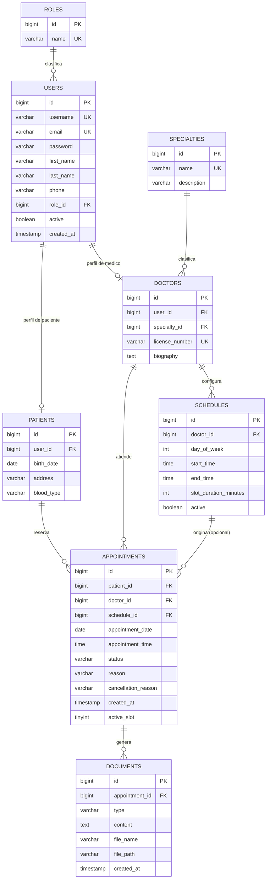

# Modelo de datos — Diagrama Entidad-Relación

Base de datos **`u_medical`** (MySQL 8). El script completo está en [`schema.sql`](schema.sql).

## Diagrama

GitHub renderiza este bloque automáticamente. Para exportarlo como imagen (PNG/SVG) debemos pegar el contenido del bloque en <https://mermaid.live>.

`active_slot` en `APPOINTMENTS` es una columna generada (ver *Reglas de integridad*). En `DOCTORS` y `PATIENTS`, `user_id` además es único (relación 1 a 1 con `USERS`).

## Diccionario de datos

**PK** clave primaria · **FK** clave foránea · **UK** valor único · **NN** no nulo.

### `roles`
| Columna | Tipo | Restricciones | Descripción |
|---|---|---|---|
| `id` | BIGINT | PK, auto-incremental | |
| `name` | VARCHAR(30) | UK, NN | `ROLE_ADMIN`, `ROLE_DOCTOR`, `ROLE_PATIENT`, `ROLE_SECRETARY` |

### `users`
Tabla unificada de usuarios; el rol se discrimina con `role_id`.

| Columna | Tipo | Restricciones | Descripción |
|---|---|---|---|
| `id` | BIGINT | PK | |
| `username` | VARCHAR(50) | UK, NN | Nombre de usuario para iniciar sesión |
| `email` | VARCHAR(100) | UK, NN | |
| `password` | VARCHAR(255) | NN | Hash **BCrypt** (nunca la contraseña en claro) |
| `first_name`, `last_name` | VARCHAR(80) | NN | |
| `phone` | VARCHAR(20) | | |
| `role_id` | BIGINT | FK → `roles.id`, NN | |
| `active` | BOOLEAN | NN, por defecto `TRUE` | Una cuenta inactiva no puede iniciar sesión ni operar |
| `created_at` | TIMESTAMP | NN, por defecto la fecha actual | |

### `specialties`
| Columna | Tipo | Restricciones |
|---|---|---|
| `id` | BIGINT | PK |
| `name` | VARCHAR(100) | UK, NN |
| `description` | VARCHAR(255) | |

### `doctors`
Perfil profesional; extiende a `users` en relación 1 a 1.

| Columna | Tipo | Restricciones | Descripción |
|---|---|---|---|
| `id` | BIGINT | PK | |
| `user_id` | BIGINT | FK → `users.id`, UK, NN, `ON DELETE CASCADE` | |
| `specialty_id` | BIGINT | FK → `specialties.id`, NN | |
| `license_number` | VARCHAR(50) | UK, NN | Número de colegiado |
| `biography` | TEXT | | |

### `patients`
Datos propios del paciente; extiende a `users` en relación 1 a 1.

| Columna | Tipo | Restricciones | Descripción |
|---|---|---|---|
| `id` | BIGINT | PK | |
| `user_id` | BIGINT | FK → `users.id`, UK, NN, `ON DELETE CASCADE` | |
| `birth_date` | DATE | | |
| `address` | VARCHAR(255) | | |
| `blood_type` | VARCHAR(5) | | Ej. `O+`, `AB-` |

### `schedules`
Bloques de atención semanales de cada médico.

| Columna | Tipo | Restricciones | Descripción |
|---|---|---|---|
| `id` | BIGINT | PK | |
| `doctor_id` | BIGINT | FK → `doctors.id`, NN, `ON DELETE CASCADE` | |
| `day_of_week` | INT | NN, `CHECK` entre 1 y 7 | 1 = lunes … 7 = domingo |
| `start_time`, `end_time` | TIME | NN, `CHECK (end_time > start_time)` | |
| `slot_duration_minutes` | INT | NN, por defecto 30 | Duración de cada cita dentro del bloque |
| `active` | BOOLEAN | NN, por defecto `TRUE` | Baja lógica del bloque |

### `appointments`
| Columna | Tipo | Restricciones | Descripción |
|---|---|---|---|
| `id` | BIGINT | PK | |
| `patient_id` | BIGINT | FK → `patients.id`, NN | |
| `doctor_id` | BIGINT | FK → `doctors.id`, NN | |
| `schedule_id` | BIGINT | FK → `schedules.id` | Bloque de origen (opcional) |
| `appointment_date` | DATE | NN | |
| `appointment_time` | TIME | NN | |
| `status` | VARCHAR(20) | NN, `CHECK`, por defecto `PENDIENTE` | `PENDIENTE`, `COMPLETADA`, `CANCELADA` |
| `reason` | VARCHAR(255) | | Motivo de la consulta |
| `cancellation_reason` | VARCHAR(255) | | Motivo si la cita se canceló |
| `created_at` | TIMESTAMP | NN | |
| `active_slot` | TINYINT | **columna generada** (`STORED`) | `1` si la cita está activa, `NULL` si está `CANCELADA` |

### `documents`
Diagnósticos y recetas de una cita.

| Columna | Tipo | Restricciones | Descripción |
|---|---|---|---|
| `id` | BIGINT | PK | |
| `appointment_id` | BIGINT | FK → `appointments.id`, NN, `ON DELETE CASCADE` | |
| `type` | VARCHAR(20) | NN, `CHECK` | `DIAGNOSTICO` o `RECETA` |
| `content` | TEXT | NN | Texto del documento |
| `file_name` | VARCHAR(255) | | Nombre original del PDF adjunto (opcional) |
| `file_path` | VARCHAR(500) | | Ruta del PDF en el servidor (opcional) |
| `created_at` | TIMESTAMP | NN | |

## Justificación de la normalización (3FN)

1. **1FN.** Todos los atributos son atómicos: no hay listas ni grupos repetidos dentro de una columna.
2. **2FN.** Todas las tablas usan una clave primaria simple (`id`), por lo que no existen dependencias parciales.
3. **3FN.** No hay dependencias transitivas:
   - Los datos exclusivos de un médico (colegiado, biografía, especialidad) están en `doctors`, y los exclusivos de un paciente (nacimiento, dirección, tipo de sangre) en `patients`, no en `users`. Así no hay columnas vacías para administradores o secretarias y cada atributo depende solo de su propia clave.
   - Los nombres del médico y del paciente **no se copian** en `appointments`: la cita solo guarda `doctor_id` y `patient_id`.
   - El catálogo de especialidades y de roles está en tablas propias referenciadas por clave foránea.
   - Los diagnósticos y recetas están en `documents`, no como columnas de la cita: una cita puede tener varios documentos.

## Reglas de integridad reforzadas en el esquema

| Regla | Mecanismo |
|---|---|
| Un médico no puede tener dos citas **activas** a la misma fecha y hora | `UNIQUE (doctor_id, appointment_date, appointment_time, active_slot)`. Como `active_slot` es `NULL` en las citas canceladas (y MySQL permite varios `NULL` en un índice único), un horario cancelado queda libre para volver a reservarse. |
| Estados de cita y tipos de documento válidos | `CHECK` sobre `appointments.status` y `documents.type` |
| Bloques de horario coherentes | `CHECK (end_time > start_time)` y `CHECK (day_of_week BETWEEN 1 AND 7)` |
| Un usuario tiene como máximo un perfil de médico y uno de paciente | `UNIQUE (user_id)` en `doctors` y `patients` |
| No quedan perfiles ni documentos huérfanos | `ON DELETE CASCADE` desde `users` hacia `doctors`/`patients`, y desde `appointments` hacia `documents` |
| Correo, usuario, colegiado y nombre de especialidad sin duplicados | `UNIQUE` en esas columnas |

Índices de apoyo: `users(role_id)`, `doctors(specialty_id)`, `schedules(doctor_id, day_of_week)`, `appointments(patient_id)`, `appointments(doctor_id, appointment_date)` y `documents(appointment_id)`.

## Datos semilla

`schema.sql` crea los 4 roles, 4 especialidades de ejemplo, 1 administrador, 2 médicos, 1 paciente y sus horarios. Los scripts opcionales `seed-secretaria.sql` y `seed-citas-pasadas.sql` agregan una secretaria y citas pasadas con documentos para probar el historial.
