# Manual del sistema

**U-Medical** — Sistema de gestión de servicios médicos.

Este manual explica qué es el sistema, cómo instalarlo y configurarlo, y cómo usar cada pantalla según el perfil de usuario.

> **Capturas de pantalla.** Las imágenes de este manual están en `docs/capturas/`.

## Contenido

1. [Introducción](#1-introducción)
2. [Instalación y configuración](#2-instalación-y-configuración)
3. [Acceso al sistema](#3-acceso-al-sistema)
4. [Perfil Paciente](#4-perfil-paciente)
5. [Perfil Secretaria](#5-perfil-secretaria)
6. [Perfil Médico](#6-perfil-médico)
7. [Perfil Administrador](#7-perfil-administrador)
8. [Reglas del sistema](#8-reglas-del-sistema)
9. [Mensajes frecuentes y solución](#9-mensajes-frecuentes-y-solución)

---

## 1. Introducción

U-Medical permite a una clínica organizar sus citas médicas. Los pacientes reservan sus propias citas, la secretaria atiende en recepción, los médicos consultan su agenda y registran diagnósticos y recetas, y el administrador gestiona usuarios, médicos, horarios y consulta estadísticas.

**Componentes**

| Componente | Descripción |
|---|---|
| Panel web | Aplicación que se usa desde el navegador. Es la que describe este manual. |
| API | Servicio central que aplica las reglas y guarda los datos. Se documenta en [`documentacion-api.md`](documentacion-api.md). |
| App móvil | Aplicación para pacientes (tareas rápidas desde el teléfono). |

**Perfiles de usuario**

| Perfil | Pantallas disponibles |
|---|---|
| Paciente | Mis citas · Agendar cita · Médicos · Mi perfil |
| Secretaria | Calendario · Pacientes (y agendar a nombre de un paciente) |
| Médico | Mi agenda |
| Administrador | Panel · Calendario · Pacientes · Médicos · Especialidades · Usuarios |

## 2. Instalación y configuración

El procedimiento completo, la configuración detallada y la solución de problemas están en la [Guía de instalación y despliegue](guia-instalacion-despliegue.md). Resumen:

1. Instalar **JDK 21**, **MySQL 8**, **Node.js 20+** y **Angular CLI 20**.
2. Crear la base de datos: `mysql -u root -p < database/schema.sql`.
3. Crear `backend/src/main/resources/local.properties` con la contraseña de MySQL y un secreto JWT de al menos 32 caracteres.
4. Iniciar el backend: `cd backend && ./mvnw spring-boot:run` (puerto 8080).
5. Iniciar el panel: `cd frontend && npm install && ng serve` (puerto 4200).
6. Abrir **http://localhost:4200**.

Usuarios de prueba (contraseña `password`): `admin`, `secretaria1`, `dr.perez`, `dra.lopez`, `paciente1`.

## 3. Acceso al sistema

### 3.1 Iniciar sesión

1. Abra http://localhost:4200. Aparece la pantalla de inicio de sesión.
2. Escriba su **usuario** y **contraseña** y presione **Ingresar**.
3. El sistema lo lleva a su pantalla principal según su perfil: el paciente a *Mis citas*, la secretaria a *Calendario*, el administrador al *Panel*.

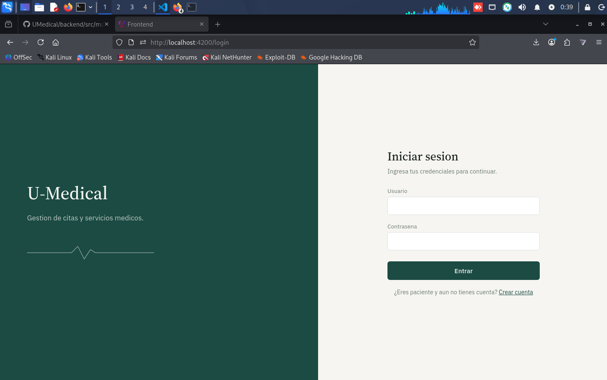

Si el usuario o la contraseña son incorrectos, se muestra un aviso y no se inicia sesión. Si su cuenta fue **desactivada** por un administrador, tampoco podrá ingresar.

### 3.2 Registro de pacientes nuevos

Los pacientes pueden crear su propia cuenta desde el enlace **Crear cuenta** de la pantalla de inicio de sesión.

1. Complete usuario, correo, contraseña (mínimo 8 caracteres), confirmación de contraseña, nombre y apellido. Teléfono, fecha de nacimiento, dirección y tipo de sangre son opcionales.
2. Presione **Crear cuenta**. Al terminar, el sistema inicia la sesión automáticamente.

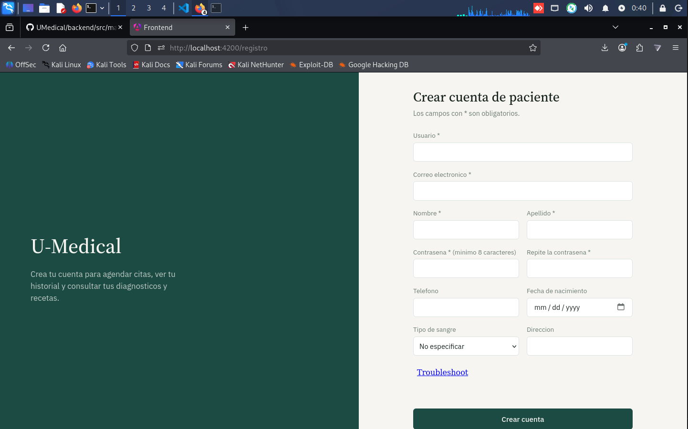

Cada campo muestra su error al lado si el dato no es válido (correo mal escrito, contraseña corta, contraseñas que no coinciden). Si el sistema detecta demasiados intentos desde su conexión, pedirá esperar unos minutos.

### 3.3 Menú, cierre de sesión y sesión vencida

- El **menú lateral** muestra solo las opciones de su perfil. En la parte inferior aparecen su nombre, su perfil y el botón **Cerrar sesión**.
- La sesión dura **24 horas**. Cuando vence, el sistema lo regresa a la pantalla de inicio de sesión.
- Si intenta abrir una pantalla que no corresponde a su perfil, verá el aviso **«No tienes acceso a esta sección»**.

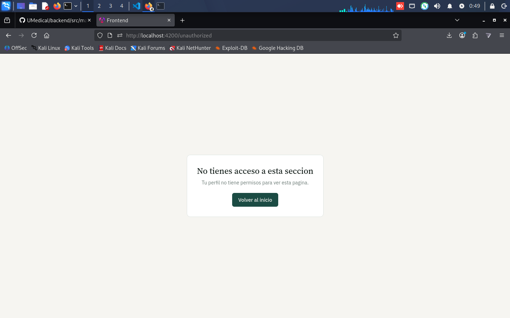

---

## 4. Perfil Paciente

### 4.1 Mis citas

Pantalla principal del paciente. Tiene dos pestañas con contador:

- **Próximas:** citas pendientes desde ahora en adelante, de la más cercana a la más lejana.
- **Historial:** citas pasadas, completadas o canceladas. Las citas que ya pasaron sin ser atendidas aparecen como **Sin atender**.

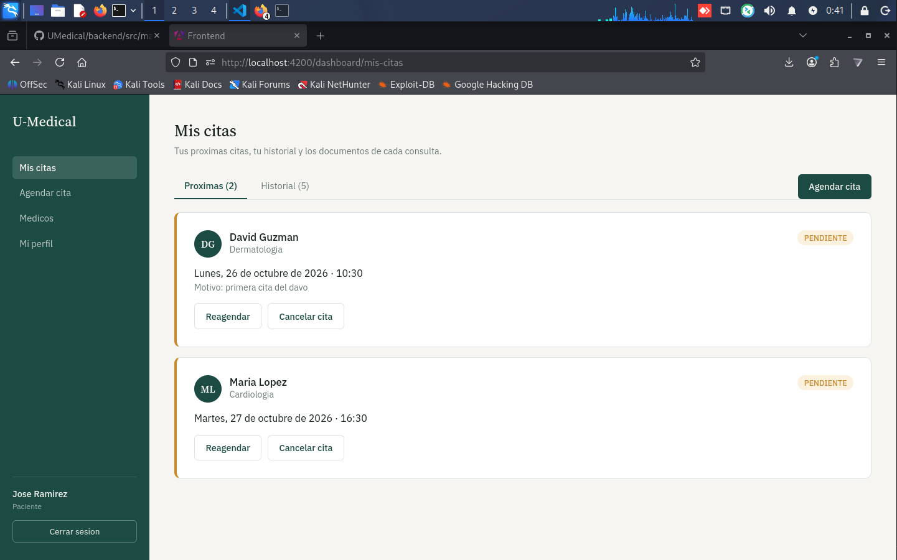

Cada cita muestra fecha, hora, médico, especialidad, motivo y estado (color: ámbar pendiente, verde completada, rojo cancelada).

**Cancelar una cita**
1. En *Próximas*, presione **Cancelar** en la cita.
2. Escriba el motivo (opcional) y confirme.
3. La cita pasa al *Historial* como *Cancelada* y su horario queda libre para otros pacientes.

**Reagendar una cita**
1. Presione **Reagendar**.
2. Elija un nuevo día y horario en el selector de disponibilidad.
3. Confirme. La cita conserva médico y motivo, y cambia de fecha y hora.

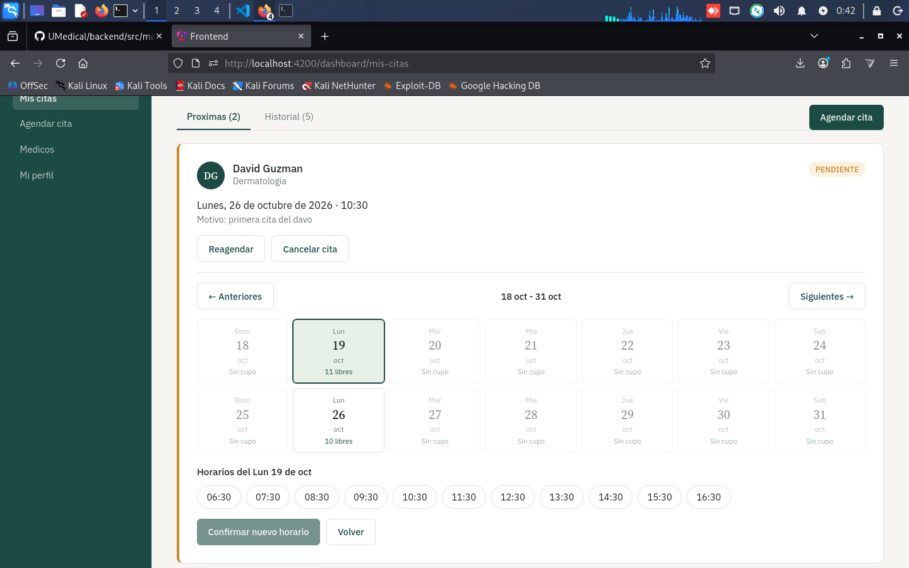

> Solo puede cancelar o reagendar con **al menos 2 horas** de anticipación. Pasado ese límite, la cita muestra un aviso y debe comunicarse con la clínica.

**Ver diagnóstico y receta.** En el *Historial*, las citas atendidas tienen el botón **Ver diagnóstico y receta**, que despliega los documentos que el médico registró (con su fecha). Si un documento tiene PDF adjunto, aparece el botón **Abrir PDF**.

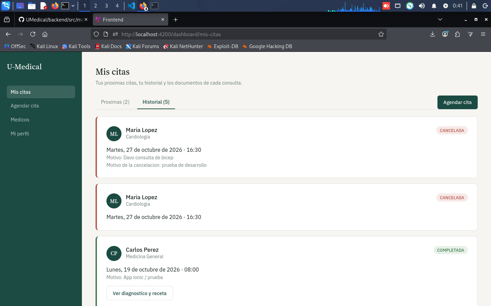

### 4.2 Agendar cita

Se hace en tres pasos:

1. **Médico.** Filtre por especialidad si lo desea y elija al médico.
2. **Día y horario.** Se muestra un calendario de 14 días: cada día indica cuántos horarios libres tiene (*«3 libres»*) y los días sin disponibilidad aparecen atenuados. Elija un día y luego una hora de la lista. Con **Anteriores / Siguientes** avanza de 14 en 14 días.
3. **Confirmar.** Revise el resumen, escriba el motivo de la consulta (opcional) y presione **Confirmar cita**.

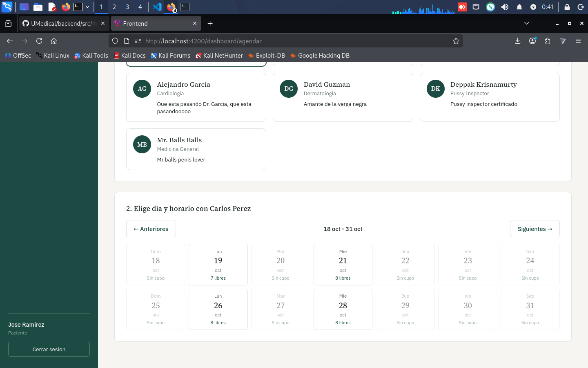
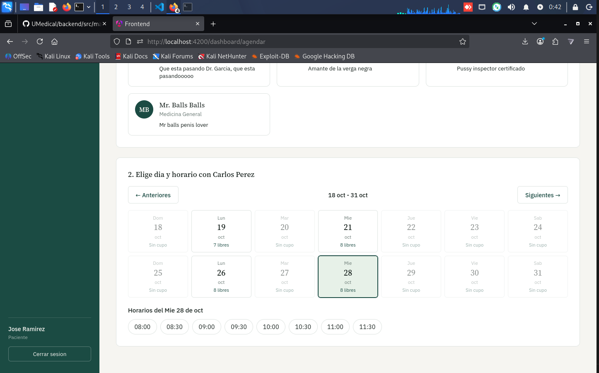

Al confirmar, el sistema muestra *«La cita quedó reservada»* y la cita aparece en *Mis citas → Próximas*. Si otra persona reservó ese horario un instante antes, el sistema avisa y se elige otro.

> El sistema solo ofrece horarios que el médico realmente atiende y que faltan **al menos 60 minutos** para empezar. No se puede tener dos citas a la misma hora, aunque sean con médicos distintos.

### 4.3 Médicos

Directorio de los médicos activos, con su especialidad, número de colegiado y presentación. Se puede filtrar por especialidad. El botón **Agendar con este médico** abre *Agendar cita* con ese médico ya seleccionado.

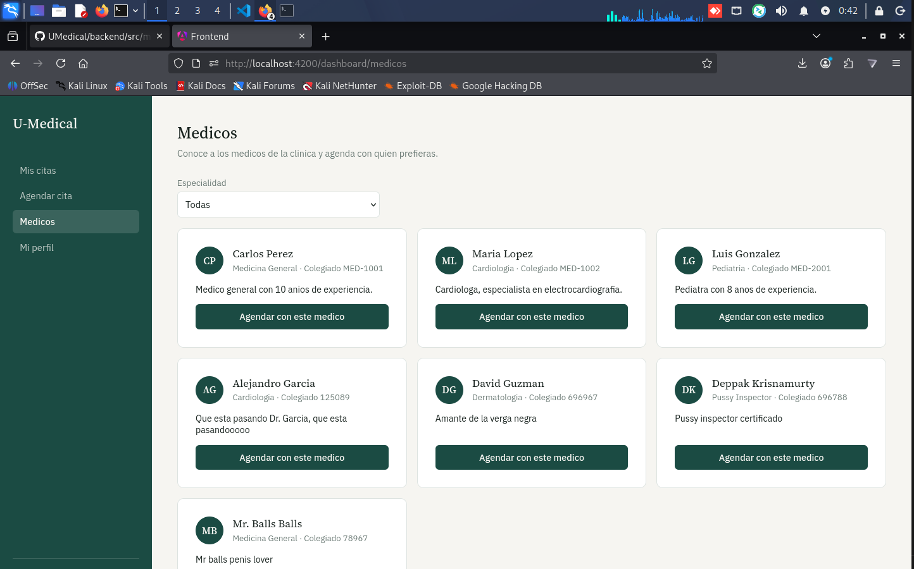

### 4.4 Mi perfil

- **Datos personales:** nombre, apellido, correo, teléfono, fecha de nacimiento, dirección y tipo de sangre. Presione **Guardar cambios**. El nombre mostrado en el menú se actualiza. El nombre de usuario no se puede cambiar.
- **Cambiar contraseña:** escriba la contraseña actual, la nueva (mínimo 8 caracteres) y su confirmación. Si la contraseña actual es incorrecta, se muestra el error y la sesión **no** se cierra.

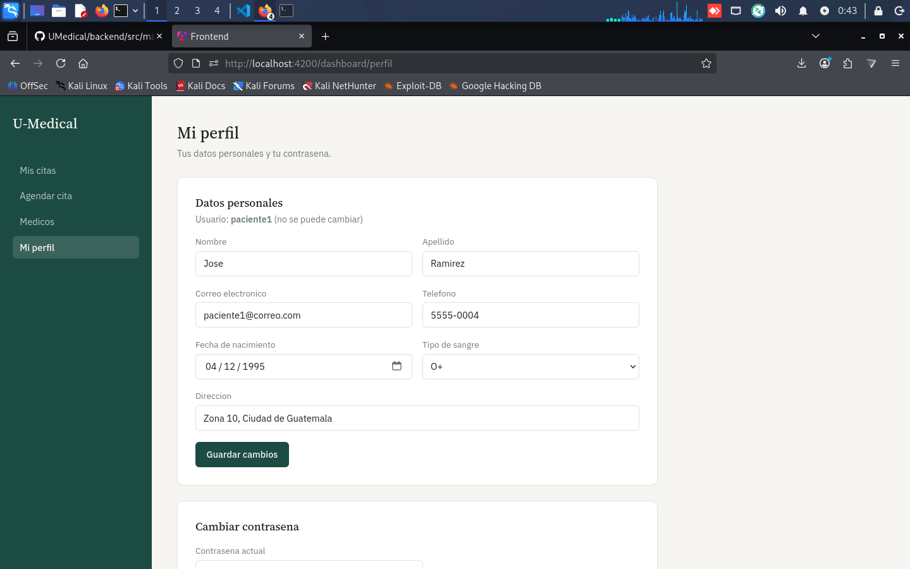

---

## 5. Perfil Secretaria

### 5.1 Calendario de la clínica

Vista semanal con las citas de **todos los médicos**, coloreadas por estado.

- **Anterior / Hoy / Siguiente** para moverse entre semanas.
- **Filtro por médico** para ver la agenda de uno solo.
- Al presionar una cita se abre su **detalle**: paciente, teléfono, médico, motivo y estado.

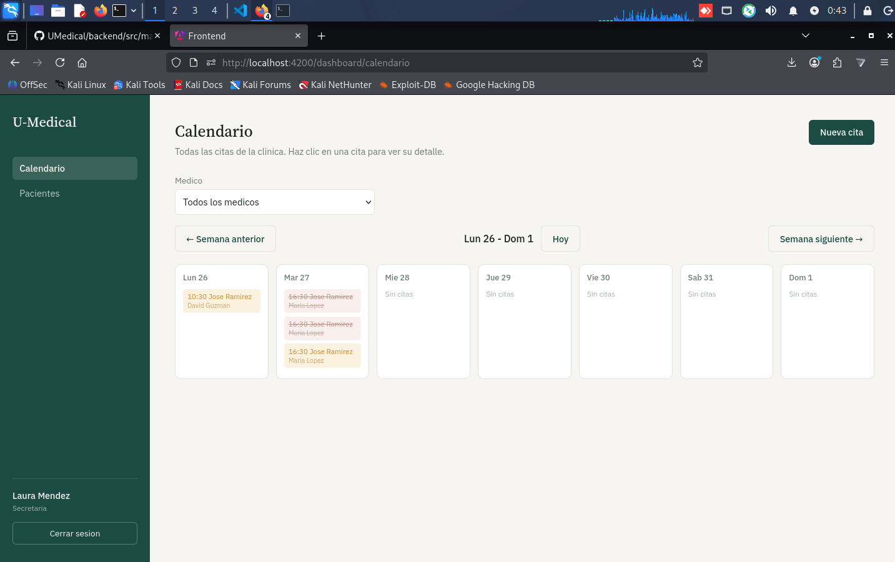

Desde el detalle de una cita pendiente se puede **Reagendar** (elegir nuevo horario) o **Cancelar** (con motivo). La secretaria no tiene el límite de 2 horas de anticipación del paciente.

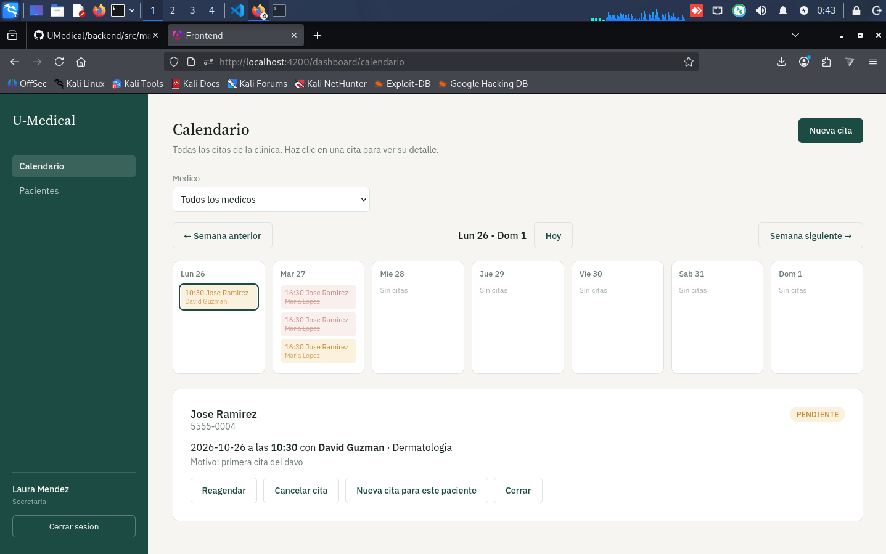

### 5.2 Pacientes

Búsqueda de pacientes por **nombre, usuario, correo o teléfono**. Cada resultado tiene el botón **Agendar cita**.

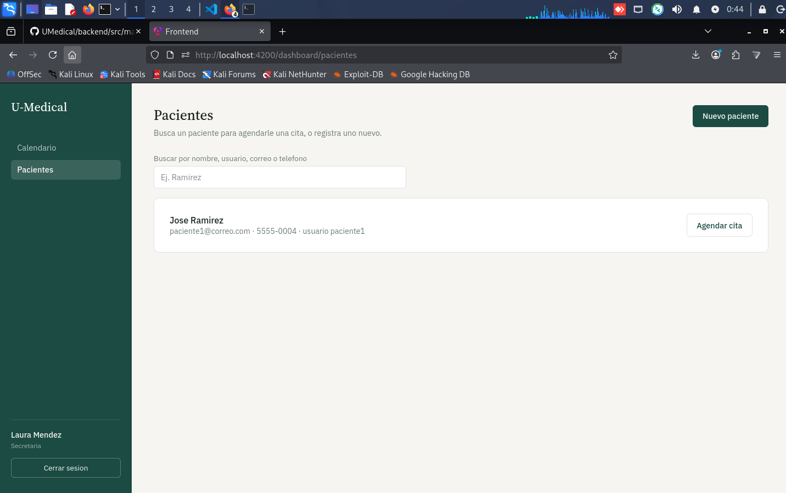

**Registrar un paciente en recepción**
1. Presione **Nuevo paciente** y complete nombre, apellido y correo (el teléfono es opcional).
2. Al guardar, el sistema crea la cuenta y muestra el **usuario** y una **contraseña temporal**, **una sola vez**. Use **Copiar** y entréguesela al paciente; podrá cambiarla desde *Mi perfil*.

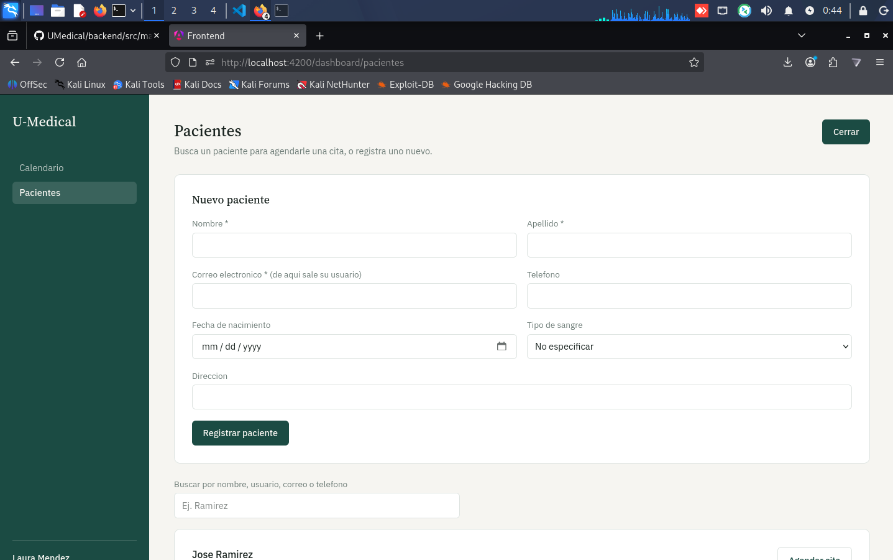

### 5.3 Agendar a nombre de un paciente

1. En *Pacientes*, busque al paciente y presione **Agendar cita**.
2. Se abre *Agendar* con el paciente ya indicado en la parte superior. Elija médico, día y horario como en el apartado 4.2 y confirme.
3. La cita aparece en el *Calendario*.

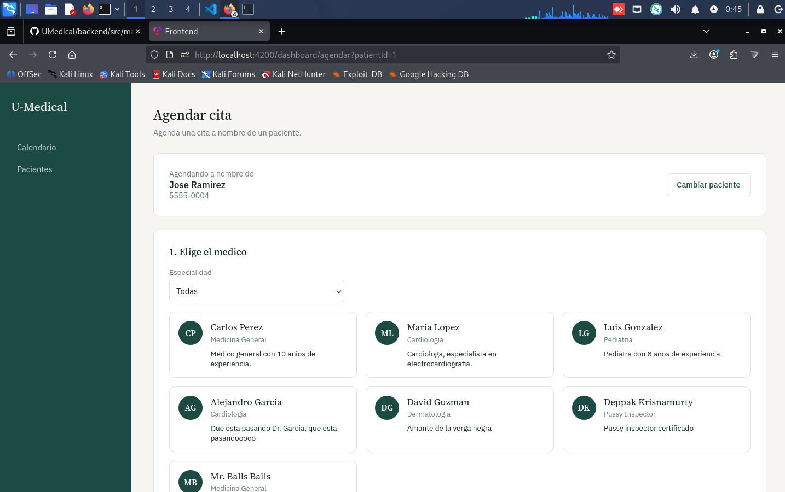

Si abre *Agendar* sin haber elegido un paciente, el sistema lo avisa y ofrece ir a *Pacientes*.

---

## 6. Perfil Médico

### 6.1 Mi agenda

Vista semanal con **sus** citas (nombre del paciente, hora y estado), con los controles **Anterior / Hoy / Siguiente**. Al elegir un día se muestra su detalle.

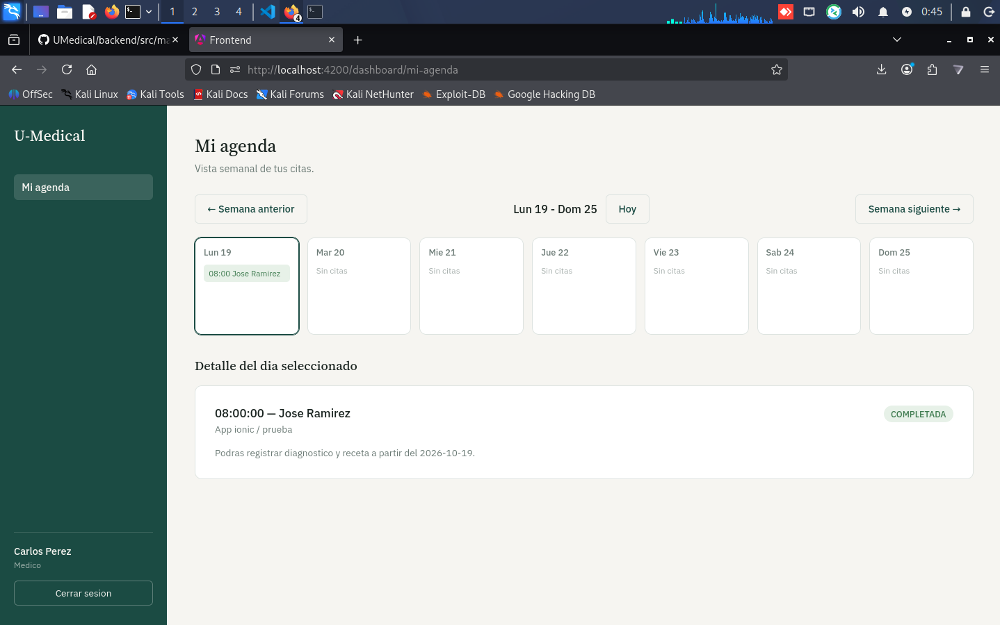

### 6.2 Registrar diagnóstico y receta

1. En el detalle de una cita **de hoy o anterior**, elija el tipo de documento (**Diagnóstico** o **Receta**) y escriba el contenido.
2. De forma opcional, **adjunte un PDF** (solo PDF, hasta 10 MB) en el mismo formulario.
3. Presione **Guardar**. La cita pasa a **Completada**.

- **El historial se conserva:** cada diagnóstico o receta que registre se **agrega** a la cita; no reemplaza los anteriores.
- Un documento ya guardado sin PDF permite **adjuntar el PDF después**. Un documento admite un solo PDF y no se reemplaza.
- El botón **Ver PDF** abre el archivo en una pestaña nueva.
- No se pueden registrar documentos en citas **futuras** (el sistema indica a partir de qué día se habilita) ni en citas **canceladas**.
- El médico puede **cancelar** una cita pendiente propia, indicando el motivo.

---

## 7. Perfil Administrador

El administrador tiene además las pantallas *Calendario* y *Pacientes* (apartado 5) y puede agendar a nombre de un paciente.

### 7.1 Panel

Resume la actividad de la clínica en un periodo.

- **Periodo:** botones *Últimos 30 días*, *Este mes*, *Próximos 30 días* y *Últimos 90 días*, o fechas **Desde / Hasta** a elección (máximo 366 días).
- **Indicadores:** citas del periodo, completadas, pendientes, canceladas (con porcentaje), sin atender, médicos activos y pacientes activos.
- **Gráficas:** citas por estado, por día, por especialidad y por médico.

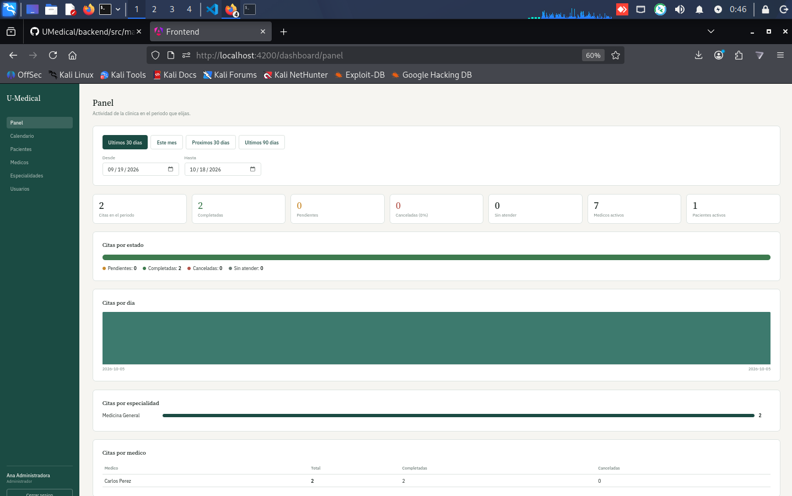

### 7.2 Usuarios

Lista de todas las cuentas del sistema con **búsqueda** (nombre, usuario o correo), **filtros** por rol y estado, y **paginación**.

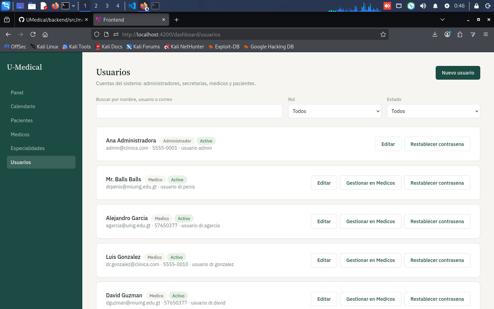

| Acción | Cómo |
|---|---|
| Crear usuario | **Nuevo usuario** → elija rol (Administrador, Secretaria o Paciente), complete los datos y guarde. Si deja vacíos el usuario y la contraseña, el sistema los genera y muestra la **contraseña temporal una sola vez**. |
| Editar | **Editar** → nombre, apellido, correo y teléfono. El rol no se puede cambiar. |
| Activar / Desactivar | **Desactivar** impide el acceso de inmediato, incluso si la persona tiene una sesión abierta. **Activar** lo restituye. |
| Restablecer contraseña | **Restablecer contraseña** genera una contraseña temporal nueva (la anterior deja de funcionar). |

Protecciones: no puede desactivar su propia cuenta ni al **último administrador activo**; los **médicos** no se crean ni se activan desde esta pantalla, sino desde *Médicos*.

### 7.3 Médicos

Lista de todos los médicos (activos e inactivos) con búsqueda y filtro por estado.

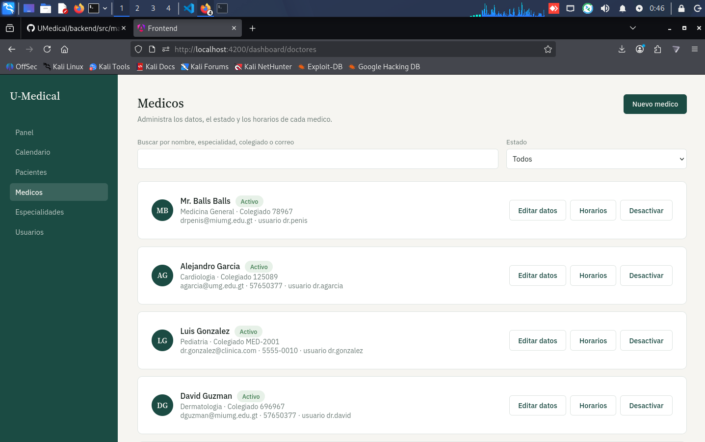

**Nuevo médico.** El formulario crea la cuenta, el perfil profesional y sus horarios **en una sola operación**: si algo falla, no se guarda nada.

1. Datos de acceso: usuario, correo y contraseña inicial.
2. Datos personales y profesionales: nombre, apellido, teléfono, especialidad, número de colegiado y biografía.
3. **Horarios de atención:** agregue uno o más bloques (día, hora de inicio, hora de fin y duración de cada cita).
4. **Guardar médico.**

El formulario valida que la hora de fin sea posterior a la de inicio, que la duración de la cita quepa en el bloque y que dos bloques del mismo día no se crucen.

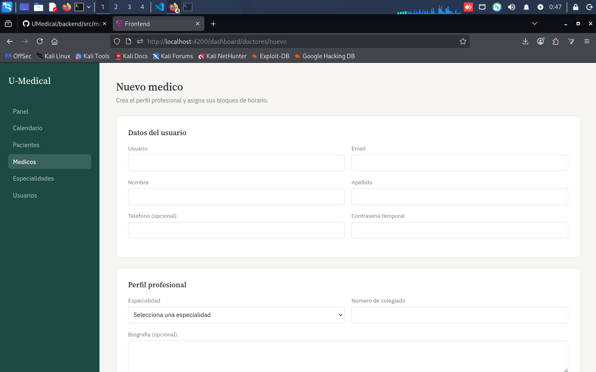

**Editar datos.** Cambia nombre, correo, teléfono, especialidad, colegiado y biografía. No se admite un correo o colegiado ya usado por otra persona.

**Activar / Desactivar.** Un médico desactivado deja de aparecer en el directorio y no recibe nuevas citas. **No se puede desactivar** a un médico que tenga citas pendientes desde hoy: primero hay que reagendarlas o cancelarlas.

**Horarios.** El botón **Horarios** abre los bloques de atención del médico: puede **agregar**, **editar** y **eliminar** bloques. El sistema rechaza un bloque que se cruce con otro y **no permite cambiar o eliminar** un bloque si eso dejaría sin horario a citas pendientes.

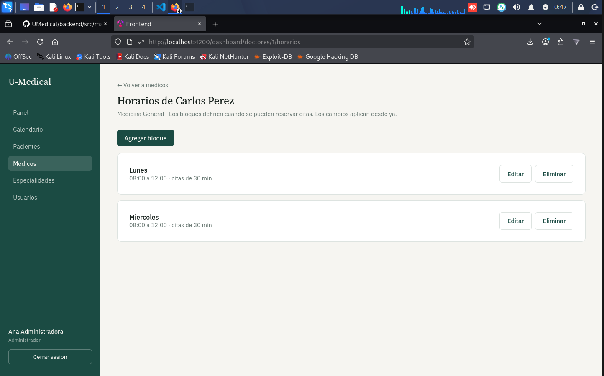

### 7.4 Especialidades

Catálogo de especialidades: se pueden **crear** y **editar**. No se admiten nombres repetidos (sin distinguir mayúsculas).

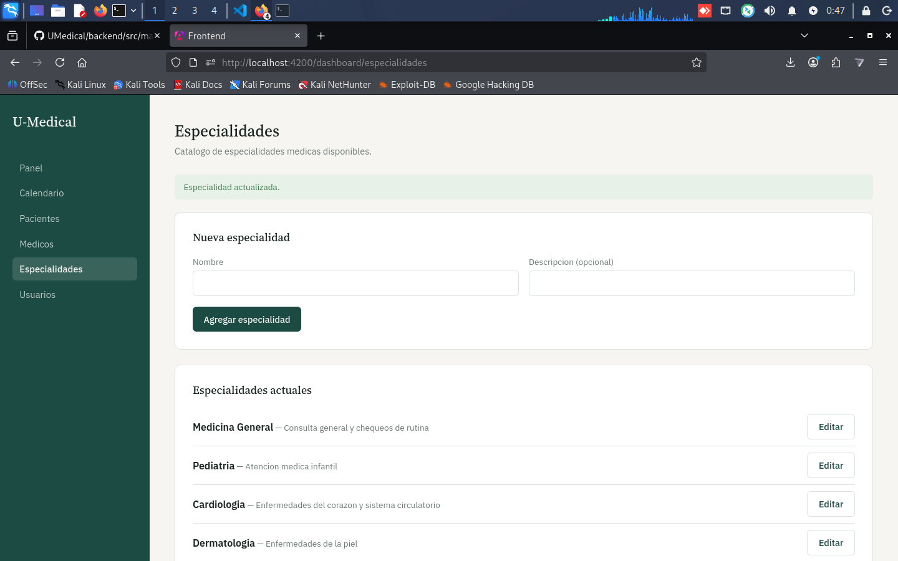

---

## 8. Reglas del sistema

| Tema | Regla |
|---|---|
| Reservar | Solo horarios del médico que estén libres y empiecen dentro de **60 minutos o más**. |
| Cita duplicada | Un paciente no puede tener dos citas activas a la misma fecha y hora. |
| Cancelar / reagendar (paciente) | Solo citas pendientes y con **2 horas o más** de anticipación. |
| Cancelar / reagendar (personal) | Solo citas pendientes; sin límite de anticipación. |
| Horario cancelado | Queda libre para reservarse de nuevo. |
| Diagnóstico y receta | Solo en citas de hoy o anteriores y no canceladas; se conserva el historial. |
| PDF | Solo formato PDF, máximo 10 MB, uno por documento. |
| Quién ve los documentos | Solo el médico de la cita y el paciente dueño de la cita. |
| Cuentas desactivadas | No pueden ingresar y su sesión deja de funcionar al instante. |
| Médico desactivado | No aparece en el directorio ni recibe nuevas citas; no se desactiva con citas pendientes. |
| Horarios de un médico | Sin cruces el mismo día; no se modifican si dejan citas pendientes sin horario. |
| Contraseñas | Mínimo 8 caracteres (al registrarse y al cambiarla). Las contraseñas temporales se muestran una sola vez. |

## 9. Mensajes frecuentes y solución

| Mensaje o situación | Qué significa | Qué hacer |
|---|---|---|
| «Usuario o contraseña incorrectos» | Datos erróneos, o la cuenta está desactivada | Verifique los datos; si persiste, contacte a un administrador |
| «No se pudo conectar con el servidor» | El servicio no responde | Verifique que el backend esté en marcha y su conexión |
| «Ese horario ya fue reservado» | Otra persona tomó el horario | Elija otro horario |
| «Faltan menos de 2 horas…» | Ya no puede cancelar o reagendar por su cuenta | Comuníquese con la clínica |
| «No tienes acceso a esta sección» | La pantalla no corresponde a su perfil | Use el menú lateral |
| La sesión se cierra sola | Venció el tiempo de sesión (24 h) o su cuenta fue desactivada | Inicie sesión de nuevo |
| «Demasiados intentos» | Límite de seguridad por conexión | Espere el tiempo indicado e intente de nuevo |
| El médico tiene citas pendientes (al desactivarlo o cambiar su horario) | Hay pacientes con cita en ese horario | Reagende o cancele esas citas primero |
